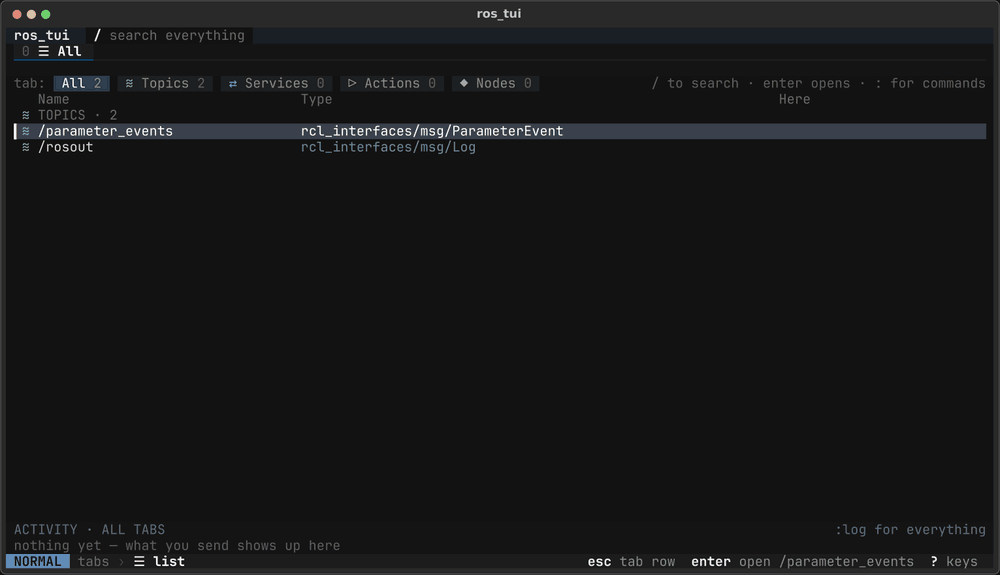

# ros_tui

[](https://github.com/johanubbink/ros-tui/actions/workflows/jazzy.yml)
[](https://github.com/johanubbink/ros-tui/actions/workflows/lyrical.yml)
[](https://github.com/johanubbink/ros-tui/actions/workflows/rolling.yml)
[](https://github.com/johanubbink/ros-tui/releases/latest)
[](LICENSE)

A terminal UI for poking at a running ROS 2 system. Browse topics,
services, actions and nodes, fill in messages field by field, and echo,
publish, call or send goals without typing `ros2 ... "{...}"` one-liners.



## Install

You need a sourced ROS 2 environment (Jazzy, Lyrical or Rolling). Nothing
else: ros_tui is a single file with its dependencies built in.

```bash
mkdir -p ~/.local/bin && curl -fsSL -o ~/.local/bin/ros_tui https://github.com/johanubbink/ros-tui/releases/latest/download/ros_tui.pyz && chmod +x ~/.local/bin/ros_tui
```

If `ros_tui` isn't found afterwards, `~/.local/bin` isn't on your `PATH` yet.
Log out and back in, or add it to your `PATH`.

Prefer a system-wide install? Use `/usr/local/bin` with `sudo` instead. To
build from source, clone the repo into a colcon workspace and
`colcon build --packages-select ros_tui`.

## Use it

Run `ros_tui` (or `ros2 run ros_tui ros_tui` from a colcon build). It opens
on a list of every topic, service, action and node in the graph.

| Key             | Does                                          |
| --------------- | --------------------------------------------- |
| `j` `k`         | move (arrows work too)                        |
| `enter` / `esc` | go in / go back                               |
| `space`         | send: publish, call, send the goal, set params |
| `/`             | find anything by name                         |
| `?`             | every key that works right now                |
| `:q`            | quit                                          |

Moving and editing never send anything; only `space` does. The full guide
is in [docs/usage.md](docs/usage.md).

## Try it without a robot

The repo has a Docker playground with demo servers. You only need Docker;
no ROS on the host.

```bash
docker/create_dot_env            # once
docker compose up --build        # start the demo servers
docker compose exec ros_tui bash # in a second terminal
ros2 run ros_tui ros_tui
```

See [docs/docker.md](docs/docker.md) for what to try.

## More docs

- [Usage](docs/usage.md): every screen and key
- [Design principles](docs/design-principles.md): why the UI works this way
- [Architecture](docs/architecture.md): how it works inside
- [Testing](docs/testing.md): running the tests and remaking the GIF

## License

Apache 2.0, see [LICENSE](LICENSE). Bundled dependencies (textual and
friends) in [`ros_tui/_vendor`](ros_tui/_vendor) keep their own licenses.
